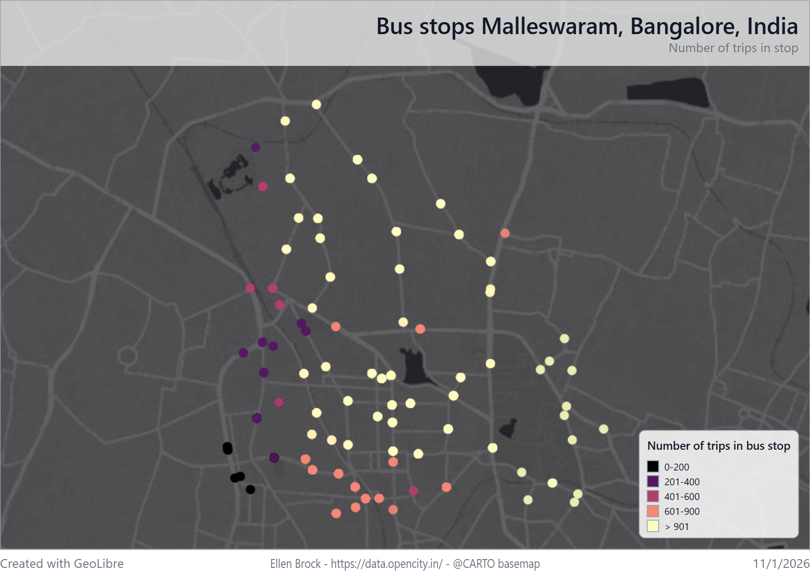
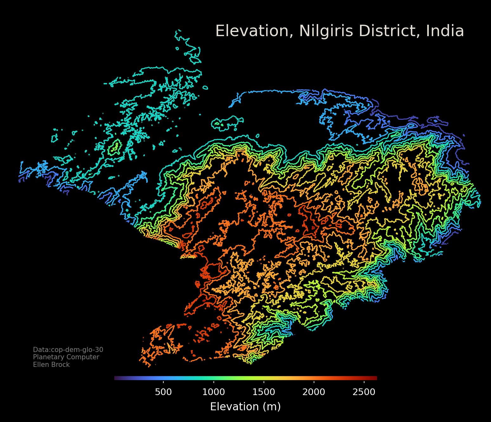
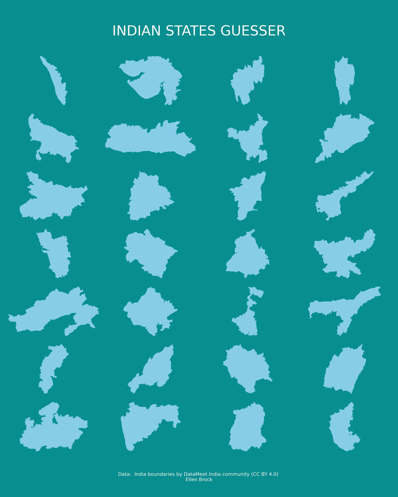
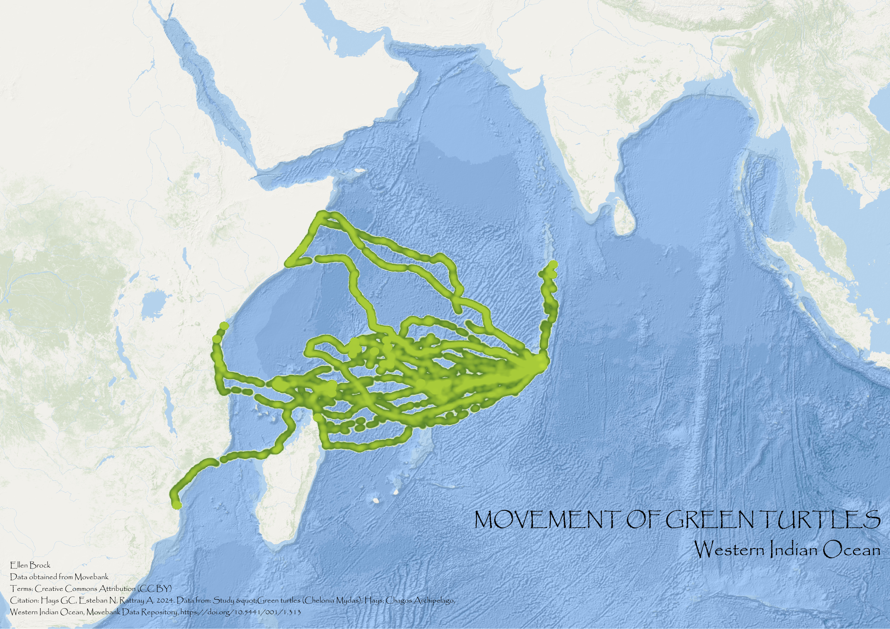
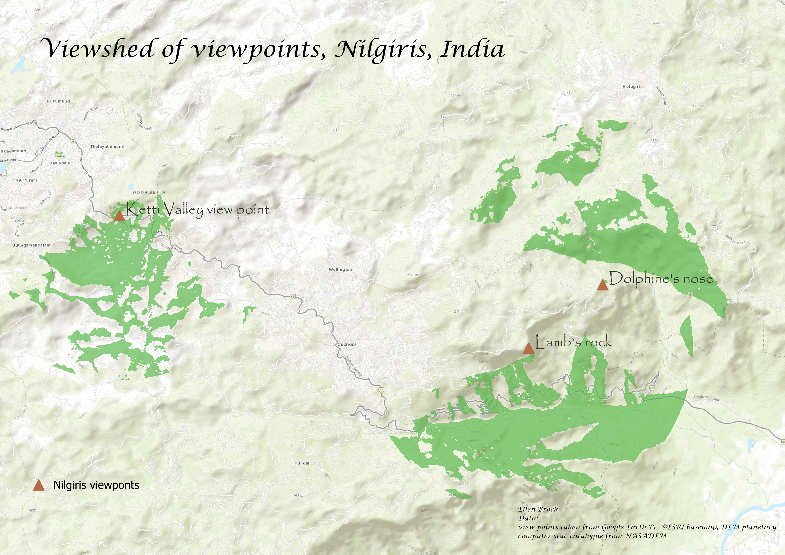
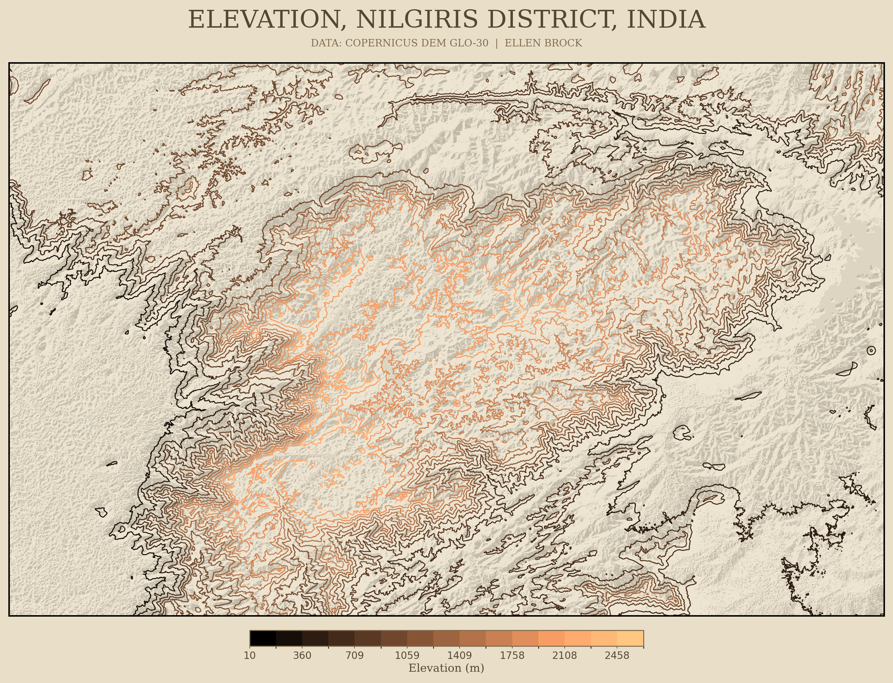
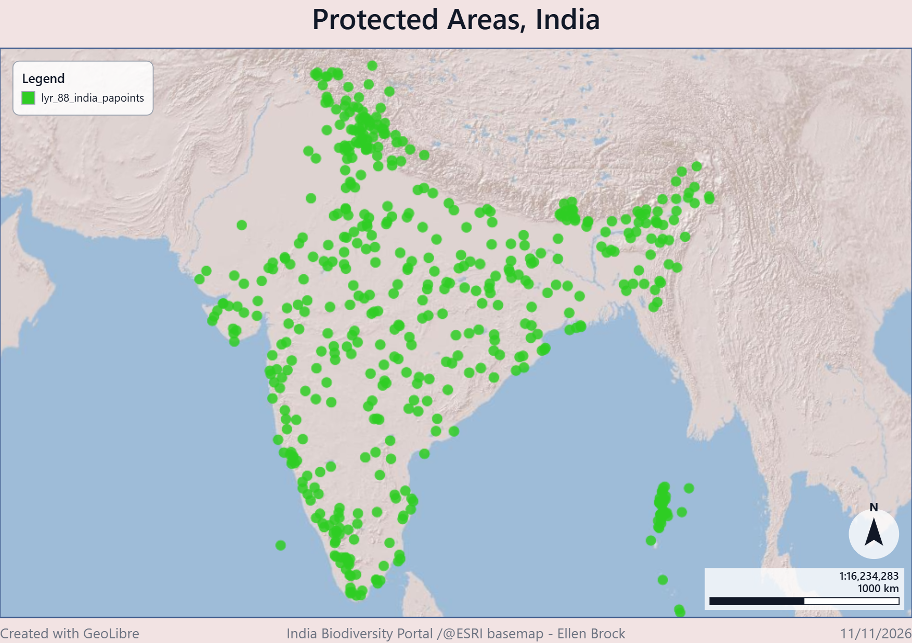
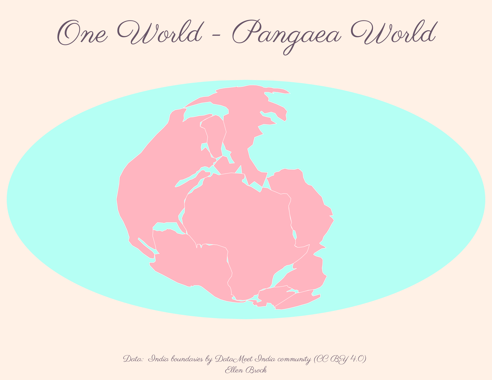

# 30-day-map-challenge-2026

## Day 1: Points (GeoLibre)

## Day 2: Lines (Python)

## Day 3: Polygons (Python)

## Day 4: Clusters (QGIS)

## Day 5: Sight (QGIS)

## Day 6: Vintage (Python)

## Day 7: 10 minute map (GeoLibre)

## Day 8: Utopia (Python)

## Day 12: Power (Python)

